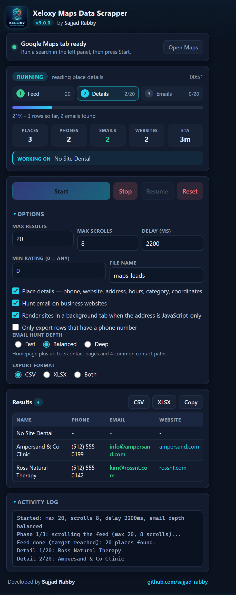
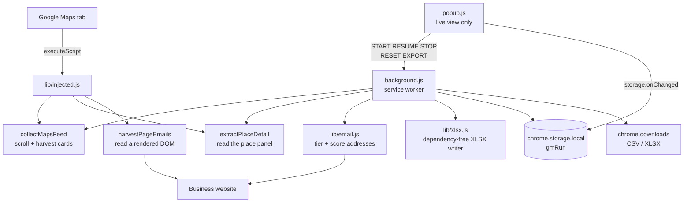

# Xeloxy Google Maps Data Scrapper

**A Chrome extension that turns a Google Maps search into a clean lead list** -
business cards, full place details, and email addresses found on the business's
own website. Runs in the background, exports CSV and XLSX.

[](LICENSE)
[](manifest.json)
[](tests/)



---

## What it does

| Area | What it does |
|---|---|
| **Feed collection** | Scrolls the Google Maps results feed, harvests every place card, and stops at your target or at the end of the list. |
| **Place details** | Opens each place for the full address, phone, website, opening hours, category, rating, review count and coordinates. |
| **Email discovery** | Hunts the business website for an address - homepage, scored contact pages, common contact paths, and a rendered-page scan for JavaScript-built sites. |
| **Ranking** | Every candidate address is scored on where it appeared, whether it sits on the business's own domain, and whether it carries the business name. |
| **Live progress** | One overall percentage, a three-step display, per-phase counters, an elapsed timer and an ETA. |
| **Resumable** | Stop, solve a captcha, press Resume. The run continues from the exact row it paused on. |
| **Export** | CSV with a UTF-8 BOM, or a real XLSX workbook with a `Leads` sheet and sized columns. |

---

## Install

**From source (recommended for developers)**

```bash
git clone https://github.com/sajjad-rabby/xeloxy-google-maps-data-scrapper.git
```

Then in Chrome:

1. Open `chrome://extensions`.
2. Turn on **Developer mode** (top right).
3. Click **Load unpacked** and choose the cloned folder.
4. Pin the extension.

**From a release**

Grab the `.zip` from the [Releases page](https://github.com/sajjad-rabby/xeloxy-google-maps-data-scrapper/releases),
unzip it, and use **Load unpacked** on the extracted folder.

---

## Use

1. Go to **google.com/maps** and run a search - for example `dentists in Austin`.
   Let the results load.
2. Click the extension icon. The header turns green when a Maps tab is found.
3. Set your options. They are remembered between runs.
4. Press **Start**. You can close the popup - the scrape keeps going.
5. Press **Resume** to carry on after a stop, or **Reset** to start over.
6. Export with **CSV**, **XLSX**, or **Copy** (tab-separated, for Sheets).

### Options

| Option | What it does |
|---|---|
| Max results | How many places to collect from the feed. |
| Max scrolls | How many times to scroll the feed looking for more. |
| Delay | Pause between requests. Higher is gentler on Google. |
| Min rating | Drop places rated below this. `0` keeps everything. |
| Deep details | Open each place page for the full address, hours, category and coordinates. |
| Find email | Hunt the business website for an email address. |
| Deep email | Also render the site in a hidden tab to catch addresses that only appear after JavaScript runs. |
| Require phone | Drop places with no phone number. |
| Email depth | `fast`, `balanced` or `deep` - see below. |
| Export format | CSV, XLSX, or both. |

### Email depth

- **fast** - the homepage plus one contact page. Quickest, lowest hit rate.
- **balanced** - the homepage, up to three contact pages, and four common
  contact paths (`/contact`, `/about`, `/impressum` and friends).
- **deep** - everything in balanced, plus more contact pages and a rendered
  page scan.

### How an email is chosen

Addresses are collected in tiers and then ranked:

| Tier | Where it came from | Confidence |
|---|---|---|
| 1 | A `mailto:` link | high |
| 2 | Text a visitor can actually see | high |
| 3 | Structured data (`meta`, JSON-LD) | medium |
| 4 | Raw markup, including hidden elements | low |

The winner is the address that scores highest on tier, whether it sits on the
business's own domain, whether it carries the business name, and penalties for
free-mail providers, very long mailboxes and tracking hashes. Vendor addresses
(`wixpress.com`, `sentry.io`, `squarespace.com` and similar) are thrown out
before scoring. Every row records the address it kept, its confidence and
where it came from, so you can judge it yourself.

---

## Architecture



The popup owns no state. It reads `gmRun` from `chrome.storage.local` and
sends commands; the background engine does the work. That means you can close
the popup mid-scrape and nothing is lost.

### The three phases

1. **Feed** - scroll the results list and collect the place cards.
2. **Details** - open each place and read the full detail panel.
3. **Emails** - visit each business website and find an address.

Each phase writes its cursor (`detailIndex`, `emailIndex`) in the *same*
storage transaction as the row it belongs to, so a worker restart can neither
skip nor repeat a row.

### Reliability

- Every run-state write goes through **one serialised queue**. Without it, a
  log line and a scraped row can interleave and the slower write wins,
  losing data.
- The engine runs **detached** from the message handler, so the popup can be
  closed without stopping the scrape.
- A **30 second alarm** keeps the service worker alive and, if the worker was
  killed mid-run, resumes the run automatically.
- A captcha pauses the run instead of failing it. Solve it in the Maps tab and
  press Resume.

---

## Export columns

`name`, `phone`, `address`, `email`, `rating`, `reviews`, `category`,
`website`, `hours`, `latitude`, `longitude`, `maps_url`, `email_confidence`,
`email_source`.

CSV files carry a UTF-8 BOM so Excel opens them correctly. The XLSX file is a
real workbook with a `Leads` sheet and sized columns - no "format mismatch"
warning.

---

## Tests

The suite is offline and needs nothing but Node.

```bash
npm test
```

Or individually:

```bash
node tests/test_email.mjs        # 35 checks - extraction, tiers, scoring, contact links
node tests/test_xlsx.mjs         # builds a workbook and checks the bytes
node tests/test_background.mjs   # 47 checks - full run against a mock Chrome API
```

**82 checks, no network, no browser, no dependencies.**

The background test drives the real engine against a mock `chrome.*` API and
asserts the three-phase flow, the resume cursors, the storage write queue and
both export formats.

---

## Project layout

```
manifest.json          Chrome MV3 manifest
background.js          the engine: phases, cursors, keep-alive, export
popup.html/.css/.js   the live view
lib/injected.js        functions injected into the page (self-contained)
lib/email.js           tiered extraction, scoring, contact-link discovery
lib/xlsx.js            dependency-free XLSX writer (store-only ZIP)
tests/                 offline test suite
docs/screenshot.png    the popup, mid-run
```

---

## Troubleshooting

**"No Google Maps tab found"** - open `google.com/maps` and run a search
first. The extension reads the search from the active tab.

**No places found** - scroll the left panel once by hand so Google loads the
results, then press Start again.

**Few emails** - turn on **Deep email** and set the depth to **deep**. Some
businesses simply do not publish an address.

**The run stopped by itself** - open the log in the popup. A captcha or a
Google rate limit is the usual cause. Press Resume once you have dealt with
it.

---

## Privacy

Everything runs in your browser. The extension talks only to Google Maps and
to the business websites it is asked to read. Nothing is sent anywhere else.

---

## Credits

Built by **Sajjad Rabby** - <https://github.com/sajjad-rabby>

MIT licensed. See [LICENSE](LICENSE).
